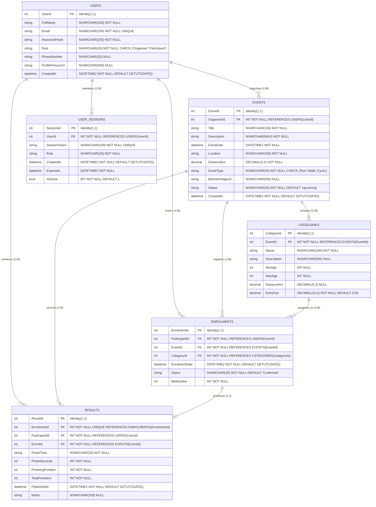

# RaceDay Platform - Entity Relationship Diagram (ERD) Specification

**Module:** PROG6212 - Advanced Programming / Programming 2B  
**Project:** RaceDay Event Management Platform (POE)  
**Deliverable:** Part 1 - System Planning and Database  

---

## 1. Overview and Relational Model Architecture

The **RaceDay** system is a high-performance web platform designed to streamline athletic event management for running, walking, and cycling competitions. The underlying data model enforces role-based security separating **Organisers** (who create and manage events, categories, and post-race results) from **Participants** (who browse events, register under specific categories, view enrolment statuses, and inspect individual race results).

The relational schema is normalized to Third Normal Form (3NF) to eliminate data redundancy and update anomalies while maintaining strict referential integrity.

---

## 2. Visual ERD Artifacts

The repository includes visual representations of the data model within the `/docs` directory:
- **PNG Diagram:** [`docs/RaceDay_ERD.png`](file:///docs/RaceDay_ERD.png) (Submitted per Part 1 specifications)
- **Scalable Vector Graphic (SVG):** [`docs/RaceDay_ERD.svg`](file:///docs/RaceDay_ERD.svg)

### Mermaid Conceptual Diagram

---

## 3. Detailed Data Dictionary

### Entity 1: `Users`
Stores account profiles, hashed credentials, and system roles for authentication.
* **`UserId` (INT, PK, Identity):** Unique user identifier.
* **`FullName` (NVARCHAR(100), NOT NULL):** Full legal/display name of the user.
* **`Email` (NVARCHAR(150), NOT NULL, UNIQUE):** Login email address.
* **`PasswordHash` (NVARCHAR(255), NOT NULL):** Cryptographically salted PBKDF2 hash.
* **`Role` (NVARCHAR(20), NOT NULL):** User role; restricted to `'Organiser'` or `'Participant'`.
* **`PhoneNumber` (NVARCHAR(20), NULL):** Contact telephone number.
* **`ProfilePictureUrl` (NVARCHAR(500), NULL):** Azure Blob Storage URI for profile photo.
* **`CreatedAt` (DATETIME2, NOT NULL, DEFAULT GETUTCDATE()):** Timestamp of registration.

### Entity 2: `Events`
Stores sporting events scheduled and managed by Organisers.
* **`EventId` (INT, PK, Identity):** Unique event identifier.
* **`OrganiserId` (INT, FK -> Users.UserId, NOT NULL):** Organiser who created and manages the event.
* **`Title` (NVARCHAR(150), NOT NULL):** Official title of the race event.
* **`Description` (NVARCHAR(MAX), NOT NULL):** Comprehensive event details and route info.
* **`EventDate` (DATETIME2, NOT NULL):** Date and start time of the race.
* **`Location` (NVARCHAR(200), NOT NULL):** Physical venue or starting coordinates.
* **`DistanceKm` (DECIMAL(5,2), NOT NULL):** Nominal race distance in kilometers.
* **`EventType` (NVARCHAR(20), NOT NULL):** Type of discipline: `'Run'`, `'Walk'`, or `'Cycle'`.
* **`BannerImageUrl` (NVARCHAR(500), NULL):** Azure Blob Storage URI for event marketing banner.
* **`Status` (NVARCHAR(20), NOT NULL, DEFAULT 'Upcoming'):** Lifecycle status: `'Upcoming'`, `'InProgress'`, `'Completed'`, `'Cancelled'`.
* **`CreatedAt` (DATETIME2, NOT NULL, DEFAULT GETUTCDATE()):** Creation timestamp.

### Entity 3: `Categories`
Defines age, distance, or competitive subdivisions within an event.
* **`CategoryId` (INT, PK, Identity):** Unique category identifier.
* **`EventId` (INT, FK -> Events.EventId, NOT NULL):** Parent event reference.
* **`Name` (NVARCHAR(100), NOT NULL):** Category tier (e.g. `'Under 20'`, `'Senior'`, `'10km'`, `'21km'`, `'Open'`).
* **`Description` (NVARCHAR(500), NULL):** Eligibility criteria or category notes.
* **`MinAge` (INT, NULL):** Minimum eligible age.
* **`MaxAge` (INT, NULL):** Maximum eligible age.
* **`DistanceKm` (DECIMAL(5,2), NULL):** Category-specific distance (if differing from overall event).
* **`EntryFee` (DECIMAL(10,2), NOT NULL, DEFAULT 0.00):** Participation cost in ZAR / Local currency.

### Entity 4: `Enrolments`
Connects Participants to Events and Categories.
* **`EnrolmentId` (INT, PK, Identity):** Unique enrolment ticket identifier.
* **`ParticipantId` (INT, FK -> Users.UserId, NOT NULL):** User entering the event.
* **`EventId` (INT, FK -> Events.EventId, NOT NULL):** Event entered.
* **`CategoryId` (INT, FK -> Categories.CategoryId, NOT NULL):** Chosen division category.
* **`EnrolmentDate` (DATETIME2, NOT NULL, DEFAULT GETUTCDATE()):** Enrolment timestamp.
* **`Status` (NVARCHAR(20), NOT NULL, DEFAULT 'Confirmed'):** Registration status: `'Confirmed'`, `'Pending'`, `'Cancelled'`.
* **`BibNumber` (INT, NOT NULL):** Unique race number assigned to the athlete.

### Entity 5: `Results`
Maintains official race completion metrics and placements.
* **`ResultId` (INT, PK, Identity):** Unique result record.
* **`EnrolmentId` (INT, FK -> Enrolments.EnrolmentId, NOT NULL, UNIQUE):** Direct 1:1 link to enrolment.
* **`ParticipantId` (INT, FK -> Users.UserId, NOT NULL):** Participant finisher.
* **`EventId` (INT, FK -> Events.EventId, NOT NULL):** Completed race.
* **`FinishTime` (NVARCHAR(20), NOT NULL):** Formatted time string (e.g. `'01:24:35'`).
* **`FinishSeconds` (INT, NOT NULL):** Total duration in seconds for efficient sorting and ranking.
* **`FinishingPosition` (INT, NOT NULL):** Final finishing rank (e.g. `47`).
* **`TotalFinishers` (INT, NOT NULL):** Total count of finishers (e.g. `312`), enabling "47th out of 312 finishers".
* **`PublishedAt` (DATETIME2, NOT NULL, DEFAULT GETUTCDATE()):** When the organiser published the official result.
* **`Notes` (NVARCHAR(250), NULL):** Remarks (e.g., `'Personal Best'`, `'Course Record'`).

### Entity 6: `UserSessions`
Maintains server-side authenticated sessions for stateful API and MVC communication.
* **`SessionId` (INT, PK, Identity):** Session record identifier.
* **`UserId` (INT, FK -> Users.UserId, NOT NULL):** Authenticated user.
* **`SessionToken` (NVARCHAR(100), NOT NULL, UNIQUE):** Secure cryptographic session identifier.
* **`Role` (NVARCHAR(20), NOT NULL):** Cached role for instant authorization checks.
* **`CreatedAt` (DATETIME2, NOT NULL, DEFAULT GETUTCDATE()):** Session establishment timestamp.
* **`ExpiresAt` (DATETIME2, NOT NULL):** Session expiration timestamp (sliding window).
* **`IsActive` (BIT, NOT NULL, DEFAULT 1):** Flag denoting active vs revoked session.

---

## 4. Cardinality and Relationship Analysis

| Relationship | Type | Parent Entity | Child Entity | Cardinality | Explanation |
| :--- | :---: | :--- | :--- | :---: | :--- |
| **Organises** | 1:M | `Users` | `Events` | `1 : 0..*` | An Organiser can create zero or many events. Each event is managed by exactly one Organiser. |
| **Subdivides** | 1:M | `Events` | `Categories` | `1 : 1..*` | An event contains one or more categories (e.g. 10km, Under 20). Each category belongs to exactly one event. |
| **Event Entry** | 1:M | `Events` | `Enrolments` | `1 : 0..*` | An event receives zero or many enrolments. Each enrolment is for one specific event. |
| **Category Selection** | 1:M | `Categories` | `Enrolments` | `1 : 0..*` | A category contains zero or many participant entries. |
| **Athlete Enrolment** | 1:M | `Users` | `Enrolments` | `1 : 0..*` | A Participant can enrol in zero or many events. Each enrolment belongs to one Participant. |
| **Race Result** | 1:1 | `Enrolments` | `Results` | `1 : 0..1` | An enrolment yields at most one official race result once the race concludes. |
| **Session Tracking** | 1:M | `Users` | `UserSessions` | `1 : 0..*` | A user can maintain active sessions across multiple devices or browser instances. |

---

## 5. Normalization Validation (3NF)

1. **First Normal Form (1NF):** All attributes contain atomic, single-valued entries. There are no repeating groups or comma-separated lists. Primary keys are defined for every table.
2. **Second Normal Form (2NF):** All non-key attributes are fully functionally dependent on the primary key, eliminating partial dependencies.
3. **Third Normal Form (3NF):** No transitive dependencies exist. Calculated metrics such as `FinishingPosition` and `TotalFinishers` are published snapshots derived strictly at event completion, ensuring historical auditability.

<!-- Added Events specifications for Run, Walk, Cycle disciplines -->

<!-- Added Categories specifications for age and distance subdivisions -->

<!-- Added Enrolments and Results 1:1 schema relationships -->

<!-- Cardinality analysis and Third Normal Form 3NF validation completed -->
