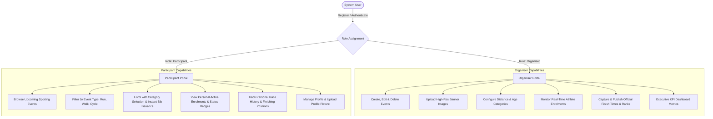
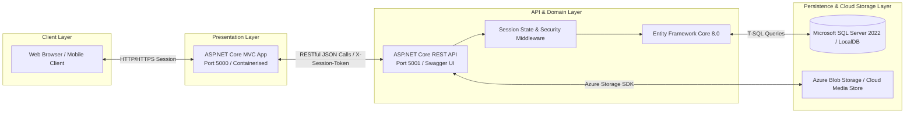

# RaceDay Platform - System Architecture & Planning Document

**Module:** PROG6212 - Advanced Programming / Programming 2B  
**Author:** Thabiso Nkosi (PROG6212 Student)  
**Deliverable:** Part 1 - System Planning and Database  
**File Location:** `/docs/System_Architecture_Plan.md`  

---

## 1. Executive Summary

**RaceDay** is an enterprise-grade athletic event management system engineered with ASP.NET Core, Entity Framework Core, SQL Server, and Azure Blob Storage. The system solves the logistical challenges of organizing, discovering, enrolling, and tracking competitive running, walking, and cycling races across Southern Africa.

The platform is designed around strict separation of concerns, decoupling presentation from data access through a microservices-aligned architecture:
- **Part 1:** System Planning, 3NF Relational ERD, API Endpoint Specifications, and SQL Server Schema DDL.
- **Part 2:** High-performance RESTful API built in ASP.NET Core with role-based session authentication, EF Core Code-First data access, Swagger documentation, and a comprehensive xUnit test suite.
- **Part 3:** Dynamic ASP.NET Core MVC front-end application with athletic UI/UX styling, Azure Blob Storage cloud media ingestion, and Docker containerisation.

---

## 2. Role-Based Architecture & System Actors

The platform strictly differentiates access and capabilities between two core user roles:

### 2.1 The Organiser Role
Organisers are athletic directors, race clubs, and event management agencies:
* Full CRUD permissions over their managed sporting events.
* Ability to define multiple competition tiers (e.g., 42.2km, 21.1km, 10km, Under 20, Masters, Open).
* Access to athlete rosters per event with real-time status filtering (Confirmed, Pending).
* Post-event interface to record finish times in `hh:mm:ss`, calculate automatic position placements, and publish official leaderboards.
* Executive dashboard displaying total registrations, upcoming dates, and event counts.

### 2.2 The Participant Role
Participants are athletes, runners, walkers, and cyclists:
* Self-service account registration and authentication.
* Interactive search and discovery of events with badge indicators for discipline (Run, Walk, Cycle).
* Single-click event enrolment with category selection, enforcing validation rules (e.g. age limits, duplicate prevention).
* Dedicated "My Enrolments" view featuring colour-coded status badges (Green for Confirmed, Amber for Pending, Red for Cancelled).
* Dedicated "My Results" race history page displaying verified finish times and placing statistics formatted as `"47th out of 312 finishers"`.
* Profile management with personal details and profile picture upload.

---

## 3. Tiered Technology Architecture

---

## 4. Security & Cryptographic Standards

1. **Password Security:** Refrains completely from plaintext storage. Utilizes the PBKDF2 (Password-Based Key Derivation Function 2) cryptographic standard with HMAC-SHA256, 100,000 iterations, and a cryptographically generated 128-bit salt.
2. **Session Security:** State is maintained via cryptographically random 256-bit session tokens stored in the `UserSessions` table. Tokens are sent via the `X-Session-Token` HTTP header or secure HTTP-only cookies, verified on each request by custom ASP.NET Core middleware.
3. **Role Authorization:** Protected controller actions enforce role requirements (`[AuthorizeRole("Organiser")]` or `[AuthorizeRole("Participant")]`). Unauthorized requests return standard `401 Unauthorized` or `403 Forbidden` status codes.

---

## 5. Verification Checklist for Part 1

- [x] Full Relational ERD with 6 distinct entities, PKs, FKs, and cardinality.
- [x] Visual ERD exported as high-resolution PNG (`docs/RaceDay_ERD.png`) and SVG (`docs/RaceDay_ERD.svg`).
- [x] Structured API Endpoint Specification table (`docs/API_Endpoint_Plan.md`) covering all functional requirements.
- [x] Complete, tested SQL Server script (`docs/RaceDay_Schema_And_Seed.sql`) with DDL, constraints, and realistic seed data (2 Organisers, 2 Participants, 3 Events, Categories, Enrolments, Results).
- [x] CI/CD validation workflow configured (`.github/workflows/ci.yml`).
